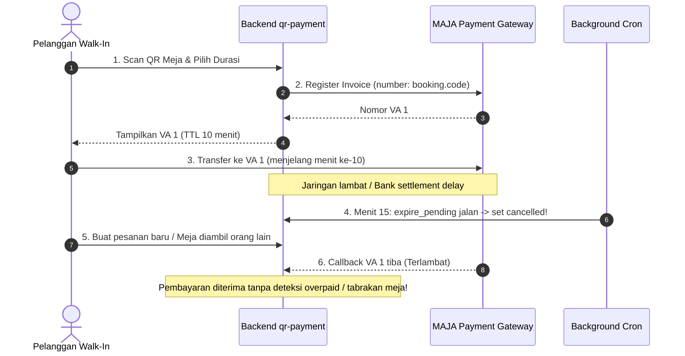
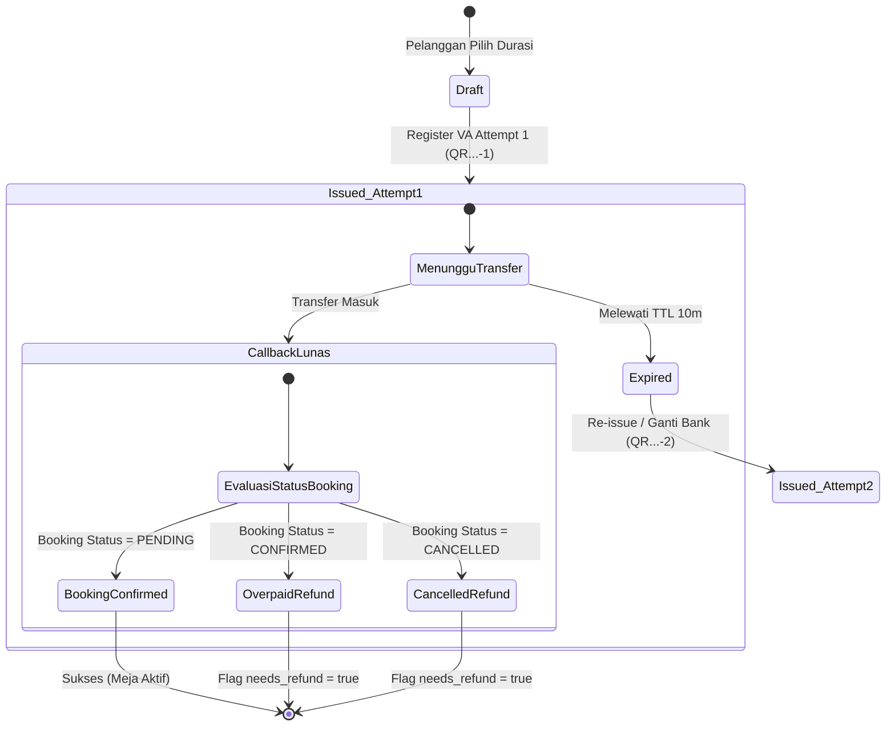

# Analisis Masalah Pembayaran & Rencana Implementasi Dekopling Invoice dan Penanganan Overpayment (`qr-payment`)

Dokumen ini mendokumentasikan analisis akar masalah kopling invoice dan risiko *double payment* pada sistem pembayaran QR Payment (Rust Axum + PostgreSQL + MAJA Billing Gateway), serta rencana implementasi teknis solusi jangka panjang.

---

## DAFTAR ISI
1. [Latar Belakang & Identifikasi Masalah](#1-latar-belakang--identifikasi-masalah)
   - [1.1 Kasus Lapangan: Double Payment & False Unpaid](#11-kasus-lapangan-double-payment--false-unpaid)
   - [1.2 Diagram Alur Masalah Eksisting](#12-diagram-alur-masalah-eksisting)
2. [Analisis Kondisi Sistem Saat Ini (Current State di qr-payment)](#2-analisis-kondisi-sistem-saat-ini-current-state-di-qr-payment)
   - [2.1 Kopling Kaku 1:1 Booking Code dengan Invoice MAJA](#21-kopling-kaku-11-booking-code-dengan-invoice-maja)
   - [2.2 Ketiadaan Siklus Re-Issue / Multi-Attempt](#22-ketiadaan-siklus-re-issue--multi-attempt)
   - [2.3 Celah Penanganan Webhook Callback di `src/webhook.rs`](#23-celah-penanganan-webhook-callback-di-srcwebhookrs)
   - [2.4 Tabel Pembayaran Eksisting (`payments`)](#24-tabel-pembayaran-eksisting-payments)
3. [Arsitektur Solusi Terpilih](#3-arsitektur-solusi-terpilih)
   - [3.1 Prinsip Desain: Dekopling & State Machine Finansial](#31-prinsip-desain-dekopling--state-machine-finansial)
   - [3.2 Format Deterministic Invoice Number](#32-format-deterministic-invoice-number)
   - [3.3 Defensive Pre-Check Inquiry](#33-defensive-pre-check-inquiry)
   - [3.4 Deteksi Overpayment & Flagging Refund](#34-deteksi-overpayment--flagging-refund)
4. [Rencana Implementasi Teknis](#4-rencana-implementasi-teknis)
   - [4.1 Migrasi Skema Database PostgreSQL](#41-migrasi-skema-database-postgresql)
   - [4.2 Pembaruan Model & DTO Rust (`src/models.rs`)](#42-pembaruan-model--dto-rust-srcmodelsrs)
   - [4.3 Refactor Endpoint Initiate & Retry/Re-issue (`src/api/public.rs`)](#43-refactor-endpoint-initiate--retryre-issue-srcapipublicrs)
   - [4.4 Refactor Logika Webhook Callback (`src/webhook.rs`)](#44-refactor-logika-webhook-callback-srcwebhookrs)
   - [4.5 Penyesuaian Background Cron Jobs (`src/jobs.rs`)](#45-penyesuaian-background-cron-jobs-srcjobsrs)
5. [State Machine Transaksi vs Booking](#5-state-machine-transaksi-vs-booking)
6. [Rencana Pengujian & Verifikasi](#6-rencana-pengujian--verifikasi)

---

## 1. Latar Belakang & Identifikasi Masalah

### 1.1 Kasus Lapangan: Double Payment & False Unpaid
Pada sistem *walk-in coworking payment*, setiap reservasi meja/ruangan menerbitkan tagihan Virtual Account (VA) atau QRIS melalui payment gateway MAJA dengan batas kedaluwarsa (*Time to Live / TTL*, default 10 menit).

Dalam operasional nyata, sering terjadi kondisi batas (*edge condition*):
1. **Kasus A: Double Payment (Overpaid)**
   - Pelanggan melakukan transfer ke VA pertama menjelang batas waktu habis.
   - Karena jaringan bank lambat atau antrean callback gateway tertahan, status di layar tetap "Menunggu Pembayaran" atau berubah menjadi kedaluwarsa.
   - Pelanggan panik atau mengganti bank/re-generate tagihan baru (Attempt 2), lalu melakukan transfer kedua.
   - **Dampak:** Uang untuk kedua tagihan berhasil terdebit di bank pelanggan dan masuk ke rekening venue. Namun, sistem belum memiliki mekanisme untuk menandai pembayaran kedua sebagai *overpaid* dan siap di-*refund*.
2. **Kasus B: False Unpaid / Slot Collision (Late Callback)**
   - Pelanggan mentransfer VA pertama.
   - Callback terlambat melampaui masa *grace period* (10 menit TTL + 5 menit cron grace), sehingga sistem membatalkan booking (`cancelled`).
   - Meja tersebut kemudian dipindai dan dipesan oleh pelanggan lain.
   - Callback pembayaran pertama baru tiba. Jika sistem membabi buta menandai booking pertama menjadi `confirmed`, terjadi tabrakan reservasi (*double booking*) pada meja/ruangan yang sama.

### 1.2 Diagram Alur Masalah Eksisting



---

## 2. Analisis Kondisi Sistem Saat Ini (Current State di qr-payment)

### 2.1 Kopling Kaku 1:1 Booking Code dengan Invoice MAJA
Di [`src/api/public.rs:97-148`](file:///home/agung/FILE/NGODING/workspace/qr-payment/src/api/public.rs#L97-L148):
```rust
let code = booking_code(); // misal "QR261112140501"
// ...
let register = RegisterRequest {
    // ...
    number: code.clone(), // Mengirim booking_code langsung sebagai nomor invoice MAJA
    // ...
};
```
Nomor invoice MAJA dan nomor booking adalah string yang sama persis. Jika pembayaran pertama gagal atau kadaluwarsa, tidak ada cara untuk membuat invoice kedua pada booking yang sama tanpa melanggar keunikan invoice di sisi MAJA.

### 2.2 Ketiadaan Siklus Re-Issue / Multi-Attempt
Saat ini fungsi `initiate_payment` hanya memiliki logika resume sederhana:
```rust
let existing = sqlx::query_as::<_, Payment>(
    "SELECT p.* FROM payments p JOIN bookings b ON b.code = p.booking_code \
     WHERE b.workspace_code = $1 AND p.status = 'issued' AND p.inactive_date > now() \
     ORDER BY p.created_at DESC LIMIT 1",
)...
```
Jika pelanggan ingin:
- Mengganti metode pembayaran (misal dari VA Mandiri ke QRIS atau VA BCA), atau
- Memperpanjang/mengulang tagihan yang belum dibayar,

sistem menolak atau memaksakan VA lama sampai habis masa berlakunya. Begitu masa berlaku habis, seluruh booking dibatalkan dan pelanggan terpaksa membuat booking baru dengan kode baru.

### 2.3 Celah Penanganan Webhook Callback di `src/webhook.rs`
Di [`src/webhook.rs:48-79`](file:///home/agung/FILE/NGODING/workspace/qr-payment/src/webhook.rs#L48-L79):
```rust
if payment.status == "paid" {
    return Ok((StatusCode::OK, Json(json!({ "ok": true, "matched": true, "idempotent": true }))));
}

let fully_paid = code == "00" && remaining.unwrap_or(0.0) <= 0.0;
if fully_paid {
    // LANGSUNG update status = 'paid' dan booking = 'confirmed'
    sqlx::query("UPDATE payments SET status = 'paid', ... WHERE id = $1")...
    sqlx::query("UPDATE bookings SET status = 'confirmed' WHERE code = $1")...
}
```
**Temuan Celah:**
1. Jika booking induk sudah `confirmed` (karena dilunasi via attempt lain atau kasir), callback kedua tetap mengeksekusi update tanpa mencatat bahwa pembayaran ini adalah kelebihan bayar (*overpaid*).
2. Jika booking induk sudah `cancelled` (karena kedaluwarsa dan slot meja mungkin sudah diisi tamu lain), booking yang mati tersebut otomatis dibangkitkan menjadi `confirmed`, memicu bentrok reservasi.
3. Tidak ada field `needs_refund` untuk menandai dana masuk yang tidak terasosiasi dengan sesi aktif.

### 2.4 Tabel Pembayaran Eksisting (`payments`)
Keuntungan di `qr-payment` adalah tabel [`payments`](file:///home/agung/FILE/NGODING/workspace/qr-payment/migrations/20240101000001_init.sql#L64-L87) sudah terpisah dari `bookings` dan memiliki relasi foreign key `booking_code`.
Kita tidak membutuhkan tabel baru, melainkan memperluas tabel `payments` agar mendukung *multiple attempts per booking*.

---

## 3. Arsitektur Solusi Terpilih

### 3.1 Prinsip Desain: Dekopling & State Machine Finansial
- **Master Ledger Transaksi:** Tabel `payments` menyimpan setiap attempt pembayaran secara independen (1 booking bisa memiliki 1..N payments).
- **Proyeksi Booking:** Tabel `bookings` merepresentasikan alokasi fisik workspace (`pending`, `confirmed`, `cancelled`, `completed`). Status `confirmed` hanya diberikan kepada pembayaran valid pertama.

### 3.2 Format Deterministic Invoice Number
Nomor invoice MAJA dibentuk dengan pola:
$$\text{Invoice Number} = \text{Booking Code} + \text{"-"} + \text{Attempt}$$
Contoh:
- Attempt 1: `QR261112140501-1`
- Attempt 2: `QR261112140501-2`

Pola ini menjamin keunikan invoice di MAJA, sekaligus mempertahankan kemampuan parsing nomor booking secara deterministik dari nomor invoice.

### 3.3 Defensive Pre-Check Inquiry
Sebelum menerbitkan attempt baru pada booking yang sama, sistem melakukan inquiry ke MAJA untuk memeriksa tagihan aktif sebelumnya. Jika pelanggan sebenarnya sudah membayar VA lama beberapa detik lalu di ATM/m-Banking, sistem langsung mengonfirmasi booking tanpa menerbitkan tagihan kedua.

### 3.4 Deteksi Overpayment & Flagging Refund
Ketika webhook menerima notifikasi lunas:
- Jika `booking.status == 'confirmed'`, maka pembayaran ini ditandai sebagai `status = 'overpaid'` dan `needs_refund = true`.
- Jika `booking.status == 'cancelled'`, status pembayaran dicatat `status = 'paid'`, `needs_refund = true`, dan booking **tidak diubah** menjadi confirmed secara sepihak untuk mencegah tabrakan meja. Notifikasi audit dicatat di `payment_events`.

---

## 4. Rencana Implementasi Teknis

### 4.1 Migrasi Skema Database PostgreSQL
File migrasi baru: `migrations/20261112000001_payment_multi_attempt.sql`

```sql
-- 1. Tambah kolom attempt dan needs_refund pada tabel payments
ALTER TABLE payments 
ADD COLUMN IF NOT EXISTS attempt INTEGER NOT NULL DEFAULT 1,
ADD COLUMN IF NOT EXISTS needs_refund BOOLEAN NOT NULL DEFAULT FALSE;

-- 2. Perbarui check constraint status pada payments untuk mendukung 'overpaid'
ALTER TABLE payments DROP CONSTRAINT IF EXISTS payments_status_check;
ALTER TABLE payments ADD CONSTRAINT payments_status_check 
CHECK (status IN ('draft', 'issued', 'paid', 'cancelled', 'failed', 'overpaid'));

-- 3. Indeks pendukung pencarian cepat per booking dan attempt
CREATE INDEX IF NOT EXISTS idx_payments_booking_attempt ON payments (booking_code, attempt);

-- 4. Perbarui data lama (backfill invoice_number format jika belum memiliki suffix)
UPDATE payments
SET invoice_number = booking_code || '-1'
WHERE invoice_number IS NOT NULL AND invoice_number NOT LIKE '%-%';
```

### 4.2 Pembaruan Model & DTO Rust (`src/models.rs`)
Menambahkan field baru pada struct `Payment` dan `PaymentDto`:

```rust
// In src/models.rs:
pub struct Payment {
    // ... field eksisting ...
    pub attempt: i32,
    pub needs_refund: bool,
    // ...
}

pub struct PaymentDto {
    // ... field eksisting ...
    pub attempt: i32,
    pub needs_refund: bool,
    // ...
}
```

Menambahkan fungsi pembuat format invoice di modul:
```rust
pub fn build_invoice_number(booking_code: &str, attempt: i32) -> String {
    format!("{booking_code}-{attempt}")
}
```

### 4.3 Refactor Endpoint Initiate & Retry/Re-issue (`src/api/public.rs`)

1. **Defensive Inquiry sebelum Re-generate:**
   Jika ada pembayaran berstatus `issued` untuk booking yang sama:
   ```rust
   if let (Some(va), Some(inv)) = (&existing_payment.va, &existing_payment.invoice_number) {
       if let Ok(inq) = state.maja.inquiry(va, inv).await {
           if inq.paid == Some(true) {
               // Tagihan lama sudah lunas di bank! Tandai lunas dan selesaikan.
               mark_payment_paid(&state.pool, existing_payment.id, &inq).await?;
               return Ok(Json(load_payment_dto(&state.pool, existing_payment.id).await?));
           }
       }
   }
   ```
2. **Pembuatan Attempt Baru:**
   - Ambil attempt terakhir: `SELECT COALESCE(MAX(attempt), 0) + 1 FROM payments WHERE booking_code = $1`.
   - Bentuk nomor invoice: `let invoice_number = build_invoice_number(&booking_code, next_attempt);`.
   - Daftarkan ke MAJA dengan nomor invoice tersebut.
   - `INSERT INTO payments (...) VALUES (..., next_attempt, invoice_number, ...);` tanpa menimpa baris lama.

### 4.4 Refactor Logika Webhook Callback (`src/webhook.rs`)
Logika penanganan callback disesuaikan untuk menangani skenario *double payment* dan *late callback*:

```rust
// 1. Ambil payment beserta status booking induknya
let row = sqlx::query!(
    r#"
    SELECT p.*, b.status as booking_status, b.workspace_code
    FROM payments p
    JOIN bookings b ON b.code = p.booking_code
    WHERE p.invoice_number = $1 OR p.maja_invoice_id = $2
    ORDER BY p.created_at DESC LIMIT 1
    "#,
    number,
    maja_id
)
.fetch_optional(&state.pool)
.await?;

// 2. Idempotensi
if row.status == "paid" || row.status == "overpaid" {
    return Ok((StatusCode::OK, Json(json!({ "ok": true, "matched": true, "idempotent": true }))));
}

// 3. Evaluasi Pelunasan
if fully_paid {
    let booking_status = row.booking_status.as_str();

    if booking_status == "confirmed" {
        // KASUS DOUBLE PAYMENT: Booking sudah lunas dari attempt lain!
        sqlx::query!(
            r#"
            UPDATE payments 
            SET status = 'overpaid', needs_refund = true, paid_at = now(),
                paid_amount = $2, remaining_amount = $3, bank_code = $4,
                channel = $5, ref = $6, raw_callback = $7, updated_at = now()
            WHERE id = $1
            "#,
            row.id, paid_amount, remaining_amount, bank_code, channel, ref_code, raw
        ).execute(&state.pool).await?;

        insert_event(
            &state.pool, Some(row.id), &row.booking_code, "overpaid",
            Some("maja-webhook"),
            Some("OVERPAYMENT DETECTED: Booking sudah lunas, dana ditandai needs_refund"),
            Some(&raw)
        ).await?;

        tracing::warn!(booking = %row.booking_code, invoice = ?number, "Overpayment detected; needs refund");
    } else if booking_status == "cancelled" {
        // KASUS LATE PAYMENT: Booking sudah kedaluwarsa/dibatalkan
        sqlx::query!(
            r#"
            UPDATE payments 
            SET status = 'paid', needs_refund = true, paid_at = now(),
                paid_amount = $2, remaining_amount = $3, bank_code = $4,
                channel = $5, ref = $6, raw_callback = $7, updated_at = now()
            WHERE id = $1
            "#,
            row.id, paid_amount, remaining_amount, bank_code, channel, ref_code, raw
        ).execute(&state.pool).await?;

        insert_event(
            &state.pool, Some(row.id), &row.booking_code, "paid_late",
            Some("maja-webhook"),
            Some("Pembayaran diterima setelah booking cancelled. Ditandai needs_refund untuk verifikasi manual"),
            Some(&raw)
        ).await?;
    } else {
        // ALUR NORMAL: Pembayaran pertama sah
        sqlx::query!(
            r#"
            UPDATE payments 
            SET status = 'paid', paid_at = now(), paid_amount = $2,
                remaining_amount = $3, bank_code = $4, channel = $5,
                ref = $6, raw_callback = $7, updated_at = now()
            WHERE id = $1
            "#,
            row.id, paid_amount, remaining_amount, bank_code, channel, ref_code, raw
        ).execute(&state.pool).await?;

        sqlx::query!("UPDATE bookings SET status = 'confirmed', updated_at = now() WHERE code = $1", row.booking_code)
            .execute(&state.pool).await?;

        insert_event(
            &state.pool, Some(row.id), &row.booking_code, "paid",
            Some("maja-webhook"), Some("Pembayaran lunas via MAJA"), Some(&raw)
        ).await?;
    }
}
```

### 4.5 Penyesuaian Background Cron Jobs (`src/jobs.rs`)
- `expire_pending`: Hanya membatalkan payment yang `inactive_date < now() - interval '5 minutes'` dan `status = 'issued'`.
- Bila sebuah booking memiliki attempt berikutnya yang masih `issued` dan belum expired, status booking **tidak boleh** diubah menjadi `cancelled`.

---

## 5. State Machine Transaksi vs Booking



---

## 6. Rencana Pengujian & Verifikasi

### Automated Tests
1. **Unit Test Format Invoice:** Memverifikasi pembentukan nomor invoice dengan deterministik `build_invoice_number("QR123", 1) == "QR123-1"`.
2. **Webhook Callback Idempotency Test:** Memastikan pemanggilan berulang dengan payload yang sama tidak menghasilkan duplikasi event atau eror.
3. **Double Payment Scenario Test:**
   - Simulasi 2 record payment (`QR...-1` dan `QR...-2`) pada booking yang sama.
   - Kirim callback untuk `QR...-1` $\rightarrow$ booking menjadi `confirmed`.
   - Kirim callback untuk `QR...-2` $\rightarrow$ payment kedua berstatus `overpaid` dengan `needs_refund == true`.

### Verifikasi Manual
1. Generate VA pertama melalui frontend.
2. Tunggu simulasi TTL atau panggil endpoint re-issue untuk mendapatkan VA kedua.
3. Tembak webhook simulator untuk VA pertama, verifikasi status meja lunas di UI.
4. Tembak webhook simulator untuk VA kedua, pastikan respons `200 OK` dan di database baris kedua berstatus `overpaid` dan `needs_refund = true`.

---
*Dokumen ini diperbarui khusus untuk arsitektur backend Rust qr-payment.*
