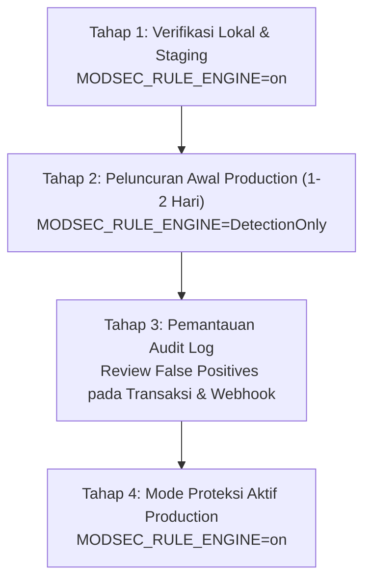

# Security Architecture: NGINX + ModSecurity WAF + OWASP CRS (qr-payment)

> Status: Siap Diimplementasikan / Standar Arsitektur Produksi  
> Target: `qr-payment` (Rust Axum + React Vite + PostgreSQL)  
> Scope: `deploy/docker-compose.yml`, `deploy/waf/`, `deploy/Dockerfile.api`, skrip deploy  
> Stack: nginx 1.30.x, ModSecurity-nginx 1.0.4, libmodsecurity 3.0.x, OWASP CRS 4.x, Rust 1.97, Axum 0.8  

---

## 1. Ringkasan Eksekutif

Upgrade keamanan ini menambahkan lapisan **NGINX + ModSecurity 3 + OWASP Core Rule Set (CRS)** di depan backend Rust (Axum) untuk memfilter serangan umum aplikasi web (SQL Injection, Cross-Site Scripting / XSS, Remote Code Execution, Path Traversal, HTTP anomalies, dan automated vulnerability scanners) sebelum request menyentuh aplikasi atau database PostgreSQL.

Berdasarkan evaluasi atas insiden dan pelajaran pada implementasi sistem sebelumnya (lihat Bab 6), arsitektur untuk backend Rust ini menggunakan pendekatan **Dedicated WAF Service / Sidecar Container** di dalam Docker Compose, bukan menggabungkan NGINX dan Rust ke dalam satu kontainer via supervisord.

Pendekatan ini menjamin:
1. **Zero Multi-Process Conflicts**: Tidak ada supervisord yang berisiko gagal membaca konfigurasi atau menelan log aplikasi.
2. **Native Docker Lifecycle**: Docker mengelola status kesehatan (*healthcheck*), restart, dan log kontainer secara independen.
3. **Kepatuhan API Rust**: Method `PUT` dan `DELETE` pada Admin API diizinkan secara aman tanpa terblokir oleh CRS default (Rule `911100`).
4. **Keamanan Transaksi**: Webhook billing MAJA dan alur OIDC Keycloak terlindungi tanpa risiko *false positive*.

---

## 2. Arsitektur Jaringan & Topologi

### 2.1 Aliran Trafik

```
Browser / Klien Publik
        │
        ▼  http://SERVER:8091 (Satu-satunya port publik)
┌────────────────────────────────────────────────────────┐
│ web (Frontend)                                         │
│ NGINX 1.27+ Alpine                                     │
│ • Melayani aset statis React Vite (SPA shell)          │
│ • Reverse proxy /api/* ke upstream WAF                 │
└───────────────────────────┬────────────────────────────┘
                            │
                            │ internal network Compose
                            ▼
┌────────────────────────────────────────────────────────┐
│ waf (Web Application Firewall)                         │
│ Image: owasp/modsecurity-crs:4.25.2-nginx-alpine-202611160811-lts (:8080)│
│ • Inspeksi ModSecurity v3 + OWASP CRS v4               │
│ • Blokir serangan (403 Forbidden)                      │
│ • Audit logging ke stdout                              │
└───────────────────────────┬────────────────────────────┘
                            │
                            │ trafik bersih yang lolos inspeksi
                            ▼
┌────────────────────────────────────────────────────────┐
│ api (Backend)                                          │
│ Rust Axum (:3000)                                      │
│ • Autentikasi JWT & OIDC Keycloak                      │
│ • Business logic pembayaran QRIS & workspace           │
└───────────────┬────────────────────────┬───────────────┘
                │                        │
                ▼                        ▼
        PostgreSQL Eksternal        MAJA Billing H2H
```

### 2.2 Kebijakan Isolasi & Keamanan Port

- **Hanya kontainer `web`** yang mempublikasikan port ke host (`8091:80`).
- Kontainer `waf` (listen di `:8080`) dan kontainer `api` (listen di `:3000`) **hanya menggunakan direktif `expose`**, sehingga keduanya berada sepenuhnya di dalam jaringan virtual internal Docker dan tidak dapat diakses langsung dari internet.
- Komunikasi antar-kontainer menggunakan nama service internal Compose (`http://waf:8080` dan `http://api:3000`).

---

## 3. Konfigurasi Komponen

### 3.1 Docker Compose (`deploy/docker-compose.yml`)

Layanan `waf` disisipkan di antara `web` dan `api`:

```yaml
name: qr-payment

services:
  api:
    image: qrpay-v-backend:latest
    build:
      context: ..
      dockerfile: deploy/Dockerfile.api
    restart: unless-stopped
    env_file:
      - /opt/qr-payment/.env
    environment:
      PORT: 3000
      TZ: Asia/Jakarta
    expose:
      - "3000"
    healthcheck:
      test: ["CMD-SHELL", "curl -fsS http://127.0.0.1:3000/api/health >/dev/null || exit 1"]
      interval: 15s
      timeout: 5s
      start_period: 10s
      retries: 3

  waf:
    image: owasp/modsecurity-crs:4.25.2-nginx-alpine-202611160811-lts
    restart: unless-stopped
    expose:
      - "8080"
    environment:
      PORT: 8080
      BACKEND: http://api:3000
      PROXY: 1
      PROXY_SSL: "off"
      SERVER_NAME: localhost
      MODSEC_RULE_ENGINE: "on"
      BLOCKING_PARANOIA: 1
      ANOMALY_INBOUND: 5
      ANOMALY_OUTBOUND: 4
      ALLOWED_METHODS: "GET HEAD POST OPTIONS PUT DELETE"
      MODSEC_REQ_BODY_LIMIT: "26214400"
      MODSEC_AUDIT_LOG: /dev/stdout
      MODSEC_AUDIT_LOG_PARTS: "ABIJDEFHZ"
      MODSEC_AUDIT_ENGINE: "RelevantOnly"
    volumes:
      - ./waf/modsecurity-override.conf:/etc/modsecurity.d/owasp-crs/rules/REQUEST-900-EXCLUSION-RULES-BEFORE-CRS.conf:ro
    depends_on:
      api:
        condition: service_healthy
    healthcheck:
      test: ["CMD-SHELL", "wget -qO- http://127.0.0.1:8080/api/health >/dev/null || exit 1"]
      interval: 15s
      timeout: 5s
      start_period: 10s
      retries: 3

  web:
    image: qrpay-v-frontend:latest
    build:
      context: ../frontend
      dockerfile: Dockerfile
      args:
        VITE_API_BASE_URL: ${PUBLIC_ORIGIN:?PUBLIC_ORIGIN belum diisi. Jalankan "set -a; . /opt/qr-payment/.env; set +a" lebih dulu.}
    restart: unless-stopped
    ports:
      - "8091:80"
    environment:
      API_UPSTREAM: http://waf:8080
    depends_on:
      waf:
        condition: service_healthy
```

### 3.2 Penyesuaian `deploy/Dockerfile.api`

Pada tahap runtime `debian:bookworm-slim`, paket `curl` ditambahkan agar Docker healthcheck internal dapat memverifikasi kesiapan biner Axum di `:3000/api/health`:

```dockerfile
FROM debian:bookworm-slim AS runtime

# ca-certificates: komunikasi HTTPS ke Keycloak & MAJA
# libssl3: native-tls (OpenSSL)
# curl: healthcheck kontainer
RUN apt-get update \
 && apt-get install -y --no-install-recommends ca-certificates libssl3 curl \
 && rm -rf /var/lib/apt/lists/*

WORKDIR /app
COPY --from=build /app/target/release/qr-payment-api /usr/local/bin/qr-payment-api

ENV PORT=3000
ENV RUST_LOG=qr_payment_api=info,tower_http=info,sqlx=warn

USER nobody
EXPOSE 3000

CMD ["/usr/local/bin/qr-payment-api"]
```

---

## 4. Penyesuaian Kebijakan WAF untuk API Rust `qr-payment`

Berkas override diletakkan di `deploy/waf/modsecurity-override.conf` dan di-mount ke lokasi `REQUEST-900-EXCLUSION-RULES-BEFORE-CRS.conf` di dalam image CRS.

### 4.1 Pengecualian Metode HTTP (`PUT` & `DELETE`)

Aturan bawaan OWASP CRS Rule `911100` (`REQUEST-911-METHOD-ENFORCEMENT.conf`) hanya mengizinkan `GET HEAD POST OPTIONS`. Rute admin Axum membutuhkan method `PUT` dan `DELETE`:
- `PUT /api/v1/admin/payment-methods/{code}`
- `PUT /api/v1/admin/workspaces/{code}`
- `PUT /api/v1/admin/lockers/{id}`
- `DELETE /api/v1/admin/lockers/{id}`
- `PUT /api/v1/admin/settings`

Selain menyetel `ALLOWED_METHODS="GET HEAD POST OPTIONS PUT DELETE"`, aturan pengecualian eksplisit dipasang sebelum CRS dievaluasi:

```apache
# 1. Izinkan PUT dan DELETE untuk rute administrasi qr-payment
SecRule REQUEST_URI "@beginsWith /api/v1/admin/" \
    "id:10010,\
    phase:1,\
    pass,\
    nolog,\
    ctl:ruleRemoveById=911100"
```

### 4.2 Webhook MAJA Billing (`/api/v1/payments/callback`)

Endpoint callback menerima payload JSON yang ditandatangani oleh gateway MAJA. Parameter hash dan signature berisiko memicu false positive pada rule deteksi SQLi atau token injection CRS (seperti rule `942100`):

```apache
# 2. Pengecualian Anomaly Scoring Khusus Webhook MAJA
SecRule REQUEST_URI "@streq /api/v1/payments/callback" \
    "id:10020,\
    phase:1,\
    pass,\
    nolog,\
    ctl:ruleRemoveById=942100,\
    ctl:ruleRemoveById=941100"
```

### 4.3 Alur Autentikasi Keycloak OIDC

Rute `/api/auth/callback` menerima parameter query string `code` (berisi token otorisasi acak panjang) dan `state` (string acak pelindung CSRF). Pada `BLOCKING_PARANOIA=1`, format ini lolos secara aman tanpa memicu false positive.

### 4.4 Bebas WebSocket

Berbeda dengan proyek lain yang mengoperasikan Socket.IO realtime, `qr-payment` menggunakan model RESTful HTTP murni untuk transaksi dan webhook asynchronous. Karena itu, **tidak diperlukan konfigurasi bypass WAF untuk WebSocket (`ctl:ruleEngine=Off`)**, sehingga seluruh request tanpa kecuali tetap terinspeksi penuh.

---

## 5. Pelajaran dari Insiden Proyek Acuan (uiadv-competition)

Dokumen acuan mencatat dua kegagalan fatal pada implementasi awal:

### 5.1 Insiden 502 Bad Gateway Akibat Supervisord di Alpine

Pada proyek sebelumnya, NGINX dan Node.js digabung ke dalam satu kontainer Alpine menggunakan supervisord.
- **Akar Masalah**: Alpine membaca konfigurasi di `/etc/supervisor.d/*.ini`, sementara Dockerfile menulis ke `/etc/supervisor/conf.d/app.conf`. Akibatnya, supervisord berjalan sebagai PID 1 dengan **0 program termuat**. Aplikasi backend tidak pernah menyala, port backend tidak ada yang mendengar, dan seluruh request `/api/*` membalas 502 Bad Gateway selama berjam-jam.
- **Masalah Deteksi**: Kontainer berstatus `Up` karena PID 1 (supervisord) hidup, sehingga Docker tidak pernah me-restart kontainer. Selain itu, log aplikasi ditulis ke berkas lokal di dalam kontainer sehingga `docker compose logs` kosong.
- **Solusi di `qr-payment`**: Menggunakan **Opsi Dedicated WAF Container**. Kontainer `api` hanya menjalankan biner Axum secara native. Docker mengawasi proses biner secara langsung melalui healthcheck. Jika biner mati, kontainer ditandai `unhealthy` dan dapat di-restart secara otomatis.

### 5.2 WAF Pasif Akibat Penggantian Entrypoint / `CMD`

Image `owasp/modsecurity-crs` memiliki skrip entrypoint (`20-envsubst-on-templates.sh`, `95-configure-rules.sh`) yang **hanya dieksekusi bila argumen pertama kontainer adalah `nginx`**.
- Pada implementasi awal proyek acuan, saat `CMD` diganti menjadi `["/usr/bin/supervisord", ...]`, generator template tidak dijalankan: modul ModSecurity tidak di-load, direktif `modsecurity on;` tidak pernah dibuat, dan WAF ternyata 100% pasif.
- **Solusi di `qr-payment`**: Kontainer `waf` mempertahankan entrypoint dan `CMD` bawaan image resminya (`CMD ["nginx", "-g", "daemon off;"]`), sehingga konfigurasi CRS selalu ter-generate sempurna saat container booting.

---

## 6. Strategi Peluncuran WAF (`MODSEC_RULE_ENGINE`)

Di proyek acuan `uiadv-competition`, WAF langsung diluncurkan di production dengan mode penolakan aktif (`MODSEC_RULE_ENGINE=on`). Penulis dokumen kemudian merekomendasikan strategi peluncuran bertahap untuk deploy selanjutnya:



### 6.1 Tahap 1: Lokal / Staging (`on`)
- Jalankan dengan `MODSEC_RULE_ENGINE="on"`.
- Uji seluruh endpoint normal (ambil daftar workspace, inisiasi QRIS, callback MAJA, login Keycloak, update setting admin).
- Pastikan tidak ada kode status 403 pada alur bisnis yang sah.

### 6.2 Tahap 2: Awal Production (`DetectionOnly`)
- Pasang di production dengan `MODSEC_RULE_ENGINE="DetectionOnly"`.
- Pada mode ini, request berbahaya dicatat di audit log tetapi **tidak diblokir** (status HTTP diteruskan apa adanya ke backend).
- Amati log selama 24–48 jam transaksi aktif:
  ```bash
  docker compose -f deploy/docker-compose.yml logs -f waf | grep -i "ModSecurity: Warning"
  ```

### 6.3 Tahap 3: Proteksi Penuh Production (`on`)
- Setelah audit log bersih dari false positive, ubah environment di `docker-compose.yml` menjadi:
  ```yaml
  MODSEC_RULE_ENGINE: "on"
  ```
- Lakukan recreate kontainer `waf`:
  ```bash
  docker compose -f deploy/docker-compose.yml up -d --force-recreate waf
  ```

---

## 7. Logging & Observabilitas

Audit log ModSecurity diarahkan langsung ke standard output kontainer (`MODSEC_AUDIT_LOG=/dev/stdout`).

### 7.1 Pemisahan Log yang Bersih

Dengan arsitektur multi-service, log keamanan dan log aplikasi terpisah secara jelas:
- **Log WAF / Ancaman Keamanan**:
  ```bash
  ./deploy/RUNNING-LOG-WAF.sh
  # atau
  docker compose -f deploy/docker-compose.yml logs -f --tail=100 waf
  ```
- **Log Aplikasi Rust / SQLx / Axum**:
  ```bash
  ./deploy/RUNNING-LOG-BACKEND.sh
  # atau
  docker compose -f deploy/docker-compose.yml logs -f --tail=100 api
  ```

### 7.2 Struktur Audit Log Saat Terjadi Serangan

Ketika penyerang mengirimkan payload berbahaya, ModSecurity mencatat detail aturan yang terpicu di log `waf`:

| Rule ID | Kategori Ancaman | Keterangan |
| --- | --- | --- |
| **941100** | XSS (libinjection) | Deteksi struktur injeksi skrip HTML/JS |
| **941110** | XSS Filter | Tag HTML terlarang (`<script>`) |
| **942100** | SQLi (libinjection) | Deteksi payload SQL injection |
| **930100** | Path Traversal | Upaya manipulasi path direktori (`../`) |
| **920350** | Protocol Violation | Anomali header HTTP atau host scanner |
| **949110** | Inbound Anomaly Score | Akumulasi skor anomali melebihi threshold (default 5) |

---

## 8. Client IP & Header Forwarding

Trafik melewati dua hop proxy internal:
```
Client IP (Pengunjung) ──► web (port 8091) ──► waf (port 8080) ──► api (port 3000)
```

1. **Hop 1 (`web`)**:
   Konfigurasi di `frontend/nginx.conf.template` menambahkan header standar:
   ```nginx
   proxy_set_header Host $host;
   proxy_set_header X-Real-IP $remote_addr;
   proxy_set_header X-Forwarded-For $proxy_add_x_forwarded_for;
   proxy_set_header X-Forwarded-Proto $scheme;
   ```
   Khusus `POST /api/v1/payments/callback`, NGINX hanya menerima koneksi dari IP
   MAJA `108.136.89.40` sebelum meneruskan request ke WAF. Aturan ini mengasumsikan
   NGINX menerima koneksi MAJA secara langsung; jika ada load balancer di depannya,
   `real_ip` harus dikonfigurasi hanya untuk IP load balancer tepercaya.

2. **Hop 2 (`waf`)**:
   Image bawaan OWASP CRS meneruskan seluruh header `X-Forwarded-*` ke backend `api`.

3. **Backend Rust (`api`)**:
   Axum membaca client IP melalui header `X-Forwarded-For` atau `X-Real-IP` jika logging per-IP diaktifkan di masa mendatang.

---

## 9. Prosedur Deployment & Skrip Operasional

### 9.1 Skrip Pembaruan Backend (`deploy/UPDATE-PROD-BACKEND.sh`)

Saat biner Rust diperbarui, kontainer `api`, `waf`, dan `web` dibuat ulang agar
setiap proxy me-resolve upstream yang baru:

```bash
#!/bin/bash
set -e

set -a; . /opt/qr-payment/.env; set +a
cd /opt/qr-payment/src

echo "== build image api =="
docker build -f deploy/Dockerfile.api -t qrpay-v-backend:latest .

echo "== recreate api + waf + web =="
docker compose -f deploy/docker-compose.yml up -d --force-recreate api waf web

echo "== status =="
docker compose -f deploy/docker-compose.yml ps
```

### 9.2 Skrip Pembaruan Frontend (`deploy/UPDATE-PROD-FRONTEND.sh`)

Saat frontend atau konfigurasi proxy `web` diperbarui:

```bash
#!/bin/bash
set -e

set -a; . /opt/qr-payment/.env; set +a
cd /opt/qr-payment/src

echo "== build image web =="
docker build \
  --build-arg VITE_API_BASE_URL="$PUBLIC_ORIGIN" \
  -t qrpay-v-frontend:latest \
  frontend

echo "== recreate api + waf + web =="
docker compose -f deploy/docker-compose.yml up -d --force-recreate api waf web

echo "== status =="
docker compose -f deploy/docker-compose.yml ps
```

> [!IMPORTANT]
> **Pencegahan 502 Akibat DNS Caching NGINX**  
> NGINX me-resolve nama host upstream (`waf` atau `api`) saat pertama kali menyala. Jika salah satu kontainer di-recreate secara independen, selalu gunakan `--force-recreate` bersama dengan proxy pemanggilnya untuk menghindari kesalahan pengalamatan IP internal.

---

## 10. Verifikasi & Pengujian Keamanan

Jalankan perintah pengujian berikut di server (atau mesin lokal) untuk membuktikan WAF aktif:

### 10.1 Tabel Matriks Pengujian

| Pengujian | Perintah `curl` | Hasil yang Diharapkan |
| --- | --- | --- |
| **Health Check Backend** | `curl -i http://localhost:8091/api/health` | `200 OK` (json: status ok) |
| **Public API Data** | `curl -i http://localhost:8091/api/v1/public/settings` | `200 OK` |
| **Admin API PUT (Valid)** | `curl -i -X PUT http://localhost:8091/api/v1/admin/settings -H "Content-Type: application/json" -d '{}'` | `401 Unauthorized` (ditolak guard auth Axum, **bukan 403** dari WAF) |
| **Uji Serangan XSS** | `curl -i "http://localhost:8091/api/v1/workspaces?q=%3Cscript%3Ealert(1)%3C/script%3E"` | **`403 Forbidden`** (diblokir ModSecurity) |
| **Uji Serangan SQLi** | `curl -i "http://localhost:8091/api/v1/workspaces?id=1%20OR%201=1"` | **`403 Forbidden`** (diblokir ModSecurity) |
| **Uji Path Traversal** | `curl -i "http://localhost:8091/api/v1/workspaces/../../etc/passwd"` | **`403 Forbidden`** (diblokir ModSecurity) |

### 10.2 Skrip Pengujian Otomatis Cepat

```bash
#!/bin/bash
HOST="http://localhost:8091"

echo "1. Uji endpoint legal:"
curl -s -o /dev/null -w "Health: %{http_code}\n" "$HOST/api/health"
curl -s -o /dev/null -w "Public Settings: %{http_code}\n" "$HOST/api/v1/public/settings"

echo "2. Uji serangan (harus 403):"
curl -s -o /dev/null -w "XSS Query: %{http_code}\n" "$HOST/api/v1/workspaces?q=%3Cscript%3Ealert(1)%3C/script%3E"
curl -s -o /dev/null -w "SQL Injection: %{http_code}\n" "$HOST/api/v1/workspaces?id=1%20OR%201=1"
```

---

## 11. Prosedur Rollback

Bila terjadi kendala pada lapisan WAF di server produksi, rollback dapat dilakukan tanpa downtime aplikasi dengan dua metode:

### 11.1 Rollback Darurat (Bypass Lapisan WAF)

Jika WAF memblokir transaksi sah dan perlu segera dimatikan tanpa menghentikan aplikasi:
1. Buka `deploy/docker-compose.yml`, kembalikan upstream `web` langsung ke `api`:
   ```yaml
   web:
     environment:
       API_UPSTREAM: http://api:3000
   ```
2. Jalankan:
   ```bash
   docker compose -f deploy/docker-compose.yml up -d --force-recreate web
   ```
   Trafik `/api/*` akan langsung menuju backend Axum secara normal.

### 11.2 Rollback Kode / Versi Image

Jika perlu mengembalikan ke versi rilis git sebelumnya:
```bash
cd /opt/qr-payment/src
git checkout <commit-sebelumnya>
./deploy/UPDATE-PROD-BACKEND.sh
./deploy/UPDATE-PROD-FRONTEND.sh
```

---

## 12. Checklist Pemeriksaan Pasca Deploy

- [ ] Kontainer `web`, `waf`, dan `api` berstatus `Up (healthy)`.
- [ ] Log WAF muncul bersih di `docker compose logs waf`.
- [ ] Halaman customer `/w/meja-12` menampilkan tarif dinamis dari database.
- [ ] Scan QRIS dan tombol bayar memunculkan QR dari MAJA.
- [ ] Callback webhook MAJA di `/api/v1/payments/callback` dapat diterima dan diverifikasi.
- [ ] Login admin via Keycloak OIDC berhasil.
- [ ] Update data admin via form (method PUT) tersimpan tanpa galat 403.
- [ ] Uji injeksi `?q=<script>` menghasilkan respons `403 Forbidden`.
